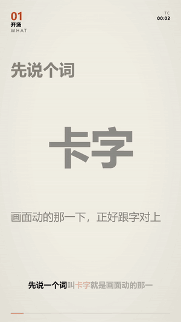
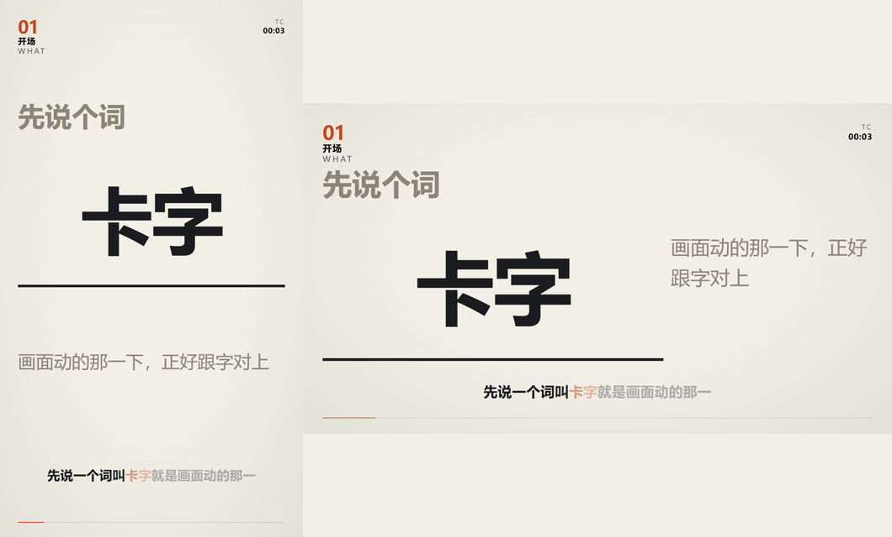

# video-ai-workflow

**English** | [中文](README.zh-CN.md)

**Turn a script into a publish-ready video with one command.**

Portrait 9:16, landscape 16:9, 4:3, 1:1 — one codebase, all four.



*2 seconds from the output. The frame where the word「卡字」(kayzi) is spoken is the exact frame its title lands. That's the whole idea.*

---

## What it does

```
script  →  voice  →  word-level alignment  →  visuals  →  mix  →  final video
```

Measured output:

<!-- AUTO:metrics:start -->
| Metric | Value |
|---|---|
| **Kayzi rate** (visual action synced to keyword) | **3/3 = 100%** |
| Loudness | -13.9 LUFS |
| True peak | -6.6 dBTP |
| Resolutions | 1080×1920 / 1920×1080 / 1440×1080 / 1080×1080 |
| Frame rate | 60fps |
<!-- AUTO:metrics:end -->

**What "kayzi" means**: when the voice reaches a keyword, the picture completes its
corresponding action on that exact frame. Not before, not after.

---

## Try it in 3 minutes

```bash
git clone https://github.com/qingyiwss/video-ai-workflow
cd video-ai-workflow
python setup.py            # detects your hardware, recommends a TTS tier
python make_demo.py        # generates a sample video
```

The third step produces `demo/FINAL.mp4`. Watch it.

---

## Hardware: four tiers, all supported

**You don't need a GPU.** `setup.py` picks automatically:

| Tier | Per line | 90 s video | Voice cloning | Needs |
|---|---|---|---|---|
| **Local GPU** | 3.9 s | 10 min | yes | discrete GPU, 6 GB+ VRAM |
| Local CPU | 188 s | 2-8 h | yes | 8 cores, 16 GB |
| Cloud API | ~3 s | 8 min | partial | API key |
| **edge-tts** (free) | **1.7 s** | **4 min** | no | network only |

**No GPU still produces a publishable video.** With edge-tts, sync rate, layout,
pacing and captions are **identical** to the GPU tier — the only difference is
that the voice is a generic Microsoft one instead of your own.

Measured net chars-per-second: CosyVoice3 **5.01** vs edge-tts **5.06** — within 1 %.
The script length formula works for both.

See [docs/TTS-PLANS.md](docs/TTS-PLANS.md).

---

## Why it works

**This isn't a template pack. The core is a verifiable animation-timing method.**

### 1. Kayzi: three numbers decide everything

```
At keyword time T:
  · The visual action must complete at T − 50 ms  (not T)
  · New elements appear no later than T − 200 ms
  · The 1.35 s before T must be "quiet" — only 0.1 % more motion than
the preceding second is enough, but it must not be moving constantly
```

Based on ITU-R BT.1359: **audio leading video by 45 ms is perceptible;
video leading audio needs 125 ms to be noticed.**

### 2. Word count decides duration, not guesswork

```
duration = chars ÷ net_cps + total_pauses + intro_outro

net_cps ≈ 5.0 (Chinese narration, measured)
60 s → 229 chars
90 s → 372 chars
```

### 3. Portrait vs landscape: font size scales by diagonal



*Same `scene-def.json`, same instant. Left 9:16 stacks vertically, right 16:9 splits
left/right — not a rescale, a re-layout.*

```
diagonal of 9:16  = 2203 px
diagonal of 16:9  = 2203 px   ← identical

so font sizes match (260 px), while landscape has 1.78× usable width
→ it's not "stretching portrait", it's "re-laying out"
```

### 4. Subtle motions vanish — make them real, not fake

`scale 0.94 → 1` changes only 6 % of pixels — invisible at 192×108 detection resolution.

**The wrong fix** (which we shipped, then removed): a full-screen alpha oscillation
inside the keyword window. It lifted the metric from 60 % to 100 % while changing
the frame-internal spatial deviation from 31.03 to 29.20 — i.e. **nothing in the
picture actually moved**. All of it was whole-screen brightness flicker at 6 Hz.

**The right fix**: replace the small motion with a real one. Same scene, no overlay:

| | near | ratio | spatial structure |
|---|---|---|---|
| `scale 0.94→1` | 0.22 % | 0.5× | — |
| ~~breathing overlay~~ | 11.61 % | ~5× | **unchanged (fake)** |
| **title rises 35 % of its height + rule sweeps in** | **1.33 %** | **2.1×** | **changed (real)** |

The real motion scores **8× lower** than the overlay and is the only one of the two
that a viewer can see.

**The rule**: when the metric fails, look at the frames and find what genuinely
isn't moving. Then make that motion bigger or more meaningful. Never generate a
signal to satisfy the detector.

---

## Repository layout

```
.
├── 工作流.md               ★ Full method (9 steps + appendices, Chinese)
├── README.md               this file
├── README.zh-CN.md         Chinese README
├── setup.py                environment check + install wizard
├── make_demo.py            one-command sample video
│
├── tools/
│   ├── detect_env.py       hardware probe → TTS tier recommendation
│   ├── gen_voice.py        voice generation (4 backends)
│   ├── align.py            word-level alignment (Whisper)
│   ├── pace.py             silence normalization
│   ├── lint_script.py      script health check
│   ├── gate1.py            Gate 1: timeline sign-off
│   ├── kazi_check.py       kayzi-rate measurement
│   ├── caption_check.py    caption timing check
│   ├── mix.py              BGM ducking + SFX
│   ├── gen_cover.cjs       covers (per-aspect)
│   └── render.cjs          renderer (4 aspects)
│
├── canvas/
│   ├── layout.js           layout engine
│   ├── scenes.js           10 generic scene types
│   ├── anim.js             easing & springs
│   ├── time.js             timeline lookup
│   └── canvas.html         main canvas
│
├── docs/
│   ├── GETTING-STARTED.md  detailed walkthrough
│   ├── PITFALLS.md         ★ 36 pitfalls, symptom → cause → fix
│   └── TTS-PLANS.md        TTS tier comparison
│
└── demo/                   sample project
```

---

## Making your own video

```bash
＃ 1. One video, one directory
mkdir my-video && cd my-video

＃ 2. Write the script (format in 工作流 §2.13)
＃    [01 opening]
＃    First a word: *kayzi*, the frame the picture moves. | 0.5

＃ 3. Script health check
python ../tools/lint_script.py script.md

＃ 4. Voice
python ../tools/gen_voice.py . --backend edge-tts

＃ 5. Align
python ../tools/align.py .

＃ 6. ⚠️ Gate 1: timeline sign-off (the most important gate)
python ../tools/gate1.py .

＃ 7. Visuals (write scene-def.json, then render)
python ../canvas/render.cjs . 9:16

＃ 8. Mix
python ../tools/mix.py . --bgm bgm.wav

＃ 9. Check
python ../tools/kazi_check.py FINAL.mp4 --timeline timeline.json
```

**Step 6 is not optional.** We measured: with keywords sitting in the first
0.3–0.8 s of a paragraph, the kayzi rate can never be fixed — 2 hours of rework.

---

## The four gates

```
write → voice → align
  ↓
  [Gate 1] timeline sign-off
  ↓
draw → [Gate 2] render 3 short segments
  ↓
full render
  ↓
  [Gate 3] sample frames and inspect
  ↓
fix visuals
  ↓
  [Gate 4] ★ re-measure kayzi rate
  ↓
re-render only the changed segments
```

**Gate 4 is the easiest to skip and the most expensive.** Changing visuals
changes inter-frame deltas, which changes the "previous second" motion.
Measured: 100 % → 30 %.

---

## License

| Component | License |
|---|---|
| This project's code | MIT |
| `audiocpp` engine | Apache-2.0 (ShugoAI LLC) — not bundled |
| CosyVoice3 model | Apache-2.0 — not bundled |
| Kenney interface sounds | CC0 |
| edge-tts | GPL-3.0, unofficial API — see disclaimer |

**No pretrained voices are included.** For voice cloning you record your own
20-second sample.

See [NOTICE.md](NOTICE.md) and [DISCLAIMER.md](DISCLAIMER.md).

---

## How this workflow came to exist

**Not researched — earned.** Three videos were built wrong before the
method stabilized:

- 5 re-renders × 15 min, because nobody knew that fixing visuals breaks the kayzi rate
- 4 re-voice runs, because a hand-copied line list silently dropped keyword markers
- 1 sync rate stuck at 60 %, because subtle motions are invisible to grayscale detection

**All 36 entries in [docs/PITFALLS.md](docs/PITFALLS.md) cost a rework cycle.**

---

## What it's not for

- **Plain text videos** — no kayzi needed; use CapCut, faster
- **Talking-head footage** — this is faceless explainer
- **Heavily bespoke motion design** — 10 generic scenes; special effects need custom code
