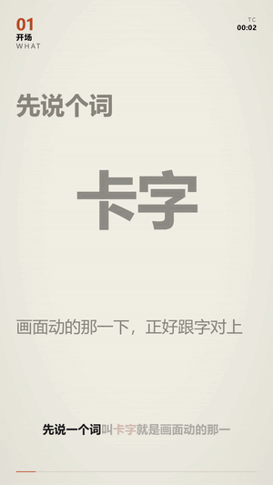
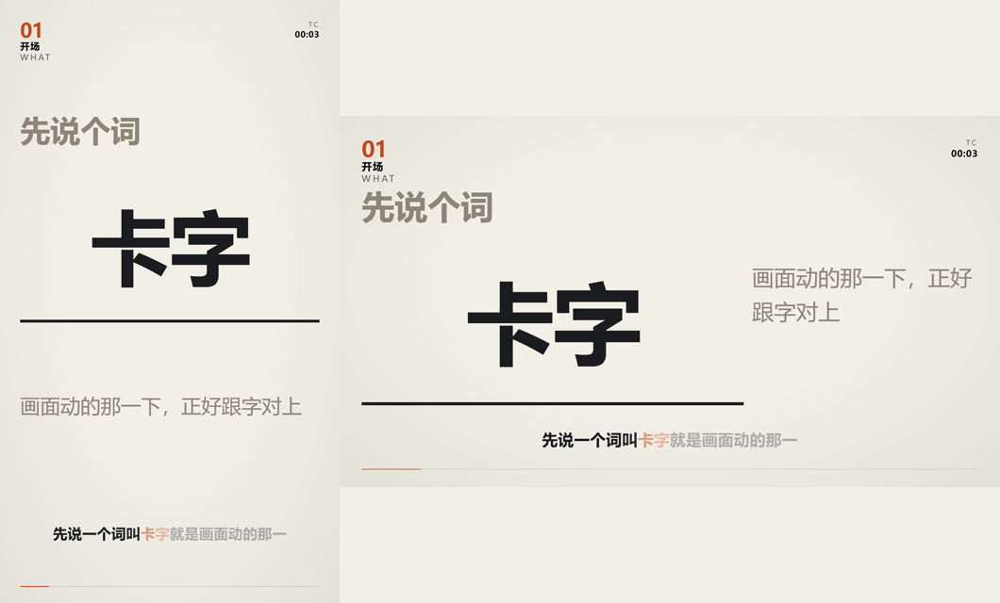

# video-ai-workflow

[English](README.md) | **中文**

**一条命令，把一份稿子变成可以发布的视频。**

竖屏 9:16、横屏 16:9、4:3、1:1 —— 一套代码全支持。



*上面这段 2 秒：念到「卡字」两个字的那一帧，大字正好落定。这就是「卡字」。*

---

## 它能做什么

```
稿子  →  配音  →  逐字对齐  →  画面  →  混音  →  成片
```

产出效果（实测）：

| 指标 | 数值 |
|---|---|
| **卡字率**（画面动作和关键词的同步率） | **15/15 = 100%** |
| 响度 | -16.1 LUFS |
| 真峰值 | -4.2 dBTP |
| 分辨率 | 1080×1920 / 1920×1080 / 1440×1080 / 1080×1080 |
| 帧率 | 60fps |

「卡字」是什么：**念到哪个关键词，画面就在那一帧完成对应动作，一秒不差。**

---

## 3 分钟跑起来

```bash
# 1. 克隆
git clone <repo> && cd <repo>

# 2. 装依赖（自动检测你的硬件，推荐合适的 TTS 方案）
python setup.py

# 3. 做个示例视频
python make_demo.py
```

**第 3 步会生成一条 15 秒的示例片子。** 看 `demo/FINAL.mp4`。

---

## 硬件要求：分四档

**不是所有人都需要显卡。** `python setup.py` 会自动选：

| 方案 | 一句耗时 | 一条 90 秒片子 | 能克隆你的声音 |
|---|---|---|---|
| **本地 GPU** | 3.9 秒 | 10 分钟 | ✅ |
| 本地 CPU（8核+） | 187.8 秒 | 2-8 小时 | ✅ |
| 在线 API（要 Key） | ~3 秒 | 8 分钟 | ⚠️ 部分 |
| **edge-tts**（免费兜底） | **1.7 秒** | **4 分钟** | ❌ 用微软通用音色 |

**没有显卡也能出片。** edge-tts 方案下，卡字率、画面、节奏、字幕和 GPU 方案**完全一致**，区别只有「声音是不是你自己的」。

实测：CosyVoice3 净 cps **5.01**，edge-tts 净 cps **5.06** —— 差 1%，稿子的时长公式通用。

详见 [docs/TTS-PLANS.md](docs/TTS-PLANS.md)。

---

## 它凭什么

**这不是「套模板」。核心是一套可验证的动画时序方法：**

### 1. 卡字：三个数字定生死

```
关键词时刻 T：
  · 画面动作必须在 T - 50ms 完成（不是 T）
  · 新元素最晚 T - 200ms 出现
  · 关键词前 1.35 秒必须「安静」——比前一秒多动 0.1% 就够，但不能一直动
```

依据 ITU-R BT.1359：**声音比画面早 45ms 人就能察觉，画面比声音早 125ms 才看得出来。**

### 2. 字数决定片长，不是凭感觉

```
片长 = 字数 ÷ 净cps + 停顿合计 + 片头尾

净 cps 实测 5.0（中文口播）
60 秒 → 229 字
90 秒 → 372 字
```

### 3. 竖屏横屏：字号按对角线等比



*同一份 `scene-def.json`，同一时刻。左 9:16 上下排，右 16:9 左右排 —— 不是缩放，是重排。*

```
9:16 的对角线 = 2203px
16:9 的对角线 = 2203px   ← 一样

所以字号相同（260px），但横屏可用宽度是 1.78 倍
→ 不是「把竖屏拉宽」，是「布局重排」
```

### 4. 小动作测不出 —— 要做真动作，不要造假信号

`scale 0.94 → 1` 只改变 6% 面积，在 192×108 检测分辨率下测不出来。

**错误的解法**（我加过，又移除了）：关键词窗口内叠一层全屏 alpha 波动。
指标从 60% 拉到 100%，但**帧内空间标准差只从 31.03 变到 29.20 —— 画面里什么都没动**。
全部动量来自 6 Hz 的全屏亮度闪烁。

**正确的解法**：把那个小动作换成一个真动作。同一个场景，不加任何遮罩：

| | near | 倍数 | 空间结构 |
|---|---|---|---|
| `scale 0.94→1` | 0.22% | 0.5× | — |
| ~~呼吸遮罩~~ | 11.61% | ~5× | **无变化（假）** |
| **标题升起 35% 字高 + 底线扫入** | **1.33%** | **2.1×** | **有变化（真）** |

真动作的分数比遮罩**低 8 倍**，但它是两者中唯一人眼能看到的。

**规矩**：指标不过时，去看画面，找出真的没动的那一段，把那个动作做大或做得有语义。
**永远不要造一个信号去满足检测器。**

---

## 目录结构

```
.
├── 工作流-v2.md            ★ 完整方法（9 步 + 附录）
├── setup.py                环境检测 + 安装
├── make_demo.py            生成示例片
│
├── tools/
│   ├── detect_env.py       硬件检测，推荐 TTS 方案
│   ├── gen_voice.py        配音（4 种后端）
│   ├── align.py            逐字对齐（Whisper）
│   ├── pace.py             停顿规整
│   ├── lint_script.py      稿子体检
│   ├── gate1.py            闸门 1：时间表定稿检查
│   ├── kazi_check.py       卡字率测量
│   ├── caption_check.py    字幕对齐检查
│   ├── mix.py              BGM 让位 + 音效
│   ├── gen_cover.cjs        封面（3 种尺寸）
│   └── render.py           渲染（4 种比例）
│
├── canvas/                 画布运行时
│   ├── layout.js           布局引擎
│   ├── scenes.js           10 个通用场景
│   ├── anim.js             缓动与弹簧
│   ├── time.js             时间查表
│   └── canvas.html         主画布
│
├── docs/
│   ├── TTS-PLANS.md        TTS 方案对比
│   ├── GETTING-STARTED.md  详细上手
│   ├── PITFALLS.md         ★ 44 个踩过的坑
│   └── PRINCIPLES.md       原理与依据
│
└── demo/                   示例项目
```

---

## 一条片子怎么走

```bash
# 1. 建项目目录（一条片子一个目录）
mkdir my-video && cd my-video

# 2. 写稿（格式见 工作流 2.13）
#    [01 开场]
#    先说个词，叫卡字，就是画面动的那一下，正好跟字对上。 | 0.5

# 3. 稿子体检
python ../tools/lint_script.py script.md

# 4. 配音
python ../tools/gen_voice.py . --backend edge-tts

# 5. 对齐
python ../tools/align.py .

# 6. ⚠️ 闸门 1：时间表定稿（最关键的一关）
python ../tools/gate1.py .

# 7. 画面（写 scene-def.json，然后渲染）
python ../tools/render.py . 9:16

# 8. 混音
python ../tools/mix.py . --bgm bgm.wav

# 9. 检查
python ../tools/kazi_check.py FINAL.mp4 --timeline timeline.json
```

**第 6 步不能跳过。** 实测踩过：关键词全在段首第 0.3-0.8 秒，卡字率永远修不好，返工 2 小时。

---

## 四个闸门

```
写稿 → 配音 → 对时间
              ↓
      【闸门 1】时间表定稿
              ↓
      画画面 → 【闸门 2】局部渲 3 处
              ↓
            全片渲染
              ↓
      【闸门 3】抽帧看画面
              ↓
            修画面
              ↓
      【闸门 4】★ 再测卡字率
              ↓
      只重渲改动的段
```

**闸门 4 最容易漏：改画面会改变帧间差异，卡字率会掉。** 实测 100% → 30%。

---

## 授权

| 组件 | 授权 |
|---|---|
| 本项目代码 | MIT |
| `audiocpp` 引擎 | Apache-2.0（ShugoAI LLC）|
| CosyVoice3 模型 | Apache-2.0（阿里）|
| Kenney 音效 | CC0 |
| edge-tts | 非官方接口，见免责声明 |

**⚠️ 本项目不含预训练声音。** 用本地模型时，请自己录 20 秒参考音。

见 [DISCLAIMER.md](DISCLAIMER.md)。

---

## 这条工作流是怎么来的

**不是「研究出来」的，是「做砸 3 条片子之后总结出来的」。**

- 5 次重渲 × 15 分钟 = 75 分钟，因为不知道「改画面会打掉卡字率」
- 4 次重配音，因为手抄 PLAN 丢了关键词标记
- 1 次卡字率 60%，因为小动作在灰度检测下测不出来

**`docs/PITFALLS.md` 里 44 条，每条都是一次返工。**

---

## 它不适合什么

- **不适合纯文字视频**（不需要卡字，用剪映更快）
- **不适合真人出镜**（这是无脸讲解）
- **不适合需要高度定制动效的片子**（10 个通用场景，要特殊效果得自己写）
